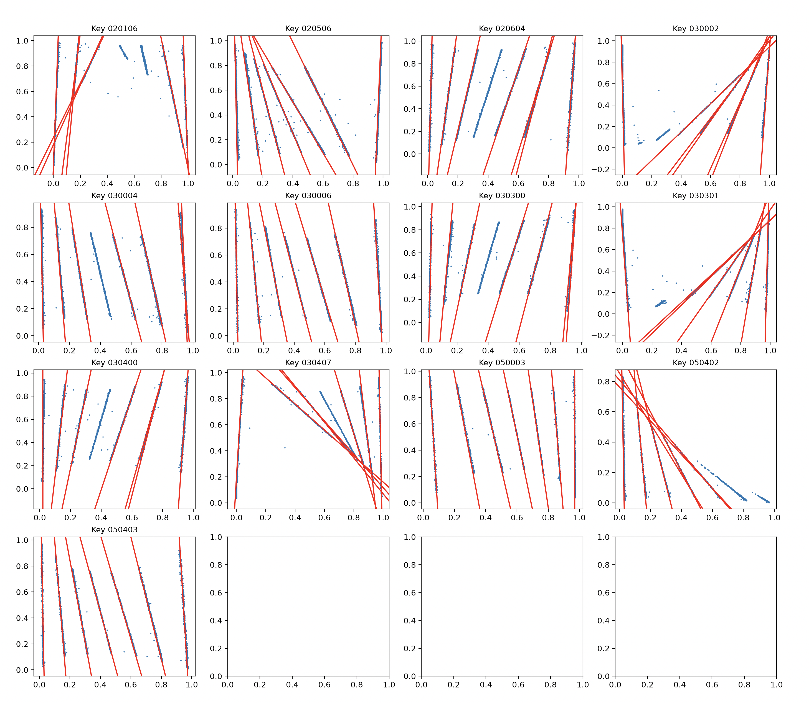

Examples
========

Finding lines
-------------

This example reads **large.txt** and finds lines that are more than 4 degrees away from vertical.

.. code-block:: text

    hough-transform/src > python hough.py -f ../data/large.txt -p -t 4.0

    020106 [(0.98, 1.763), (0.0, 1.536), (1.0, 1.606), (0.1, 1.484), (-0.07, 1.169), (0.07, 1.449), (-0.1, 1.134)]
    020506 [(0.74, 1.955), (0.32, 1.78), (0.95, 1.536), (0.18, 1.693), (0.03, 1.588), (0.46, 1.902), (0.58, 2.025)]
    020604 [(0.01, 1.553), (0.08, 1.466), (0.92, 1.518), (0.4, 1.326), (0.58, 1.344), (0.61, 1.379), (0.16, 1.396)]
    030002 [(0.23, 0.925), (0.63, 1.257), (0.39, 1.065), (0.95, 1.518), (0.01, 1.588), (0.66, 1.292), (0.42, 1.1)]
    030004 [(0.8, 1.763), (0.96, 1.606), (0.97, 1.641), (0.64, 1.798), (0.17, 1.641), (0.03, 1.588), (0.33, 1.71)]
    030006 [(0.03, 1.588), (0.8, 1.763), (0.18, 1.658), (0.97, 1.623), (0.65, 1.833), (0.49, 1.798), (0.34, 1.745)]
    030300 [(0.02, 1.553), (0.6, 1.379), (0.91, 1.518), (0.41, 1.344), (0.18, 1.414), (0.1, 1.501), (0.89, 1.501)]
    030301 [(0.97, 1.553), (0.83, 1.449), (0.04, 1.623), (0.27, 0.925), (0.45, 1.1), (0.65, 1.292), (0.25, 0.908)]
    030400 [(0.91, 1.518), (0.58, 1.361), (0.09, 1.484), (0.17, 1.414), (0.39, 1.326), (0.02, 1.571), (0.6, 1.379)]
    030407 [(0.99, 1.588), (0.82, 2.356), (-0.01, 1.518), (0.85, 2.199), (0.91, 1.833), (0.94, 1.676), (0.86, 2.234)]
    050003 [(0.54, 1.763), (0.09, 1.623), (0.97, 1.571), (0.79, 1.693), (0.89, 1.641), (0.68, 1.745), (0.35, 1.728)]
    050402 [(0.17, 1.658), (0.32, 1.815), (0.03, 1.588), (0.45, 2.042), (0.52, 2.269), (0.51, 2.304), (0.44, 2.112)]
    050403 [(0.17, 1.641), (0.03, 1.588), (0.8, 1.78), (0.97, 1.623), (0.64, 1.815), (0.33, 1.728), (0.49, 1.798)]

Saving line parameters
----------------------

The line parameters can be saved to a json file

.. code-block:: text

    hough-transform/src > python hough.py -f ../data/large.txt -p -t 4.0 -s four_degrees.json

    020106 [(0.98, 1.763), (0.0, 1.536), (1.0, 1.606), (0.1, 1.484), (-0.07, 1.169), (0.07, 1.449), (-0.1, 1.134)]
    ...
    050403 [(0.17, 1.641), (0.03, 1.588), (0.8, 1.78), (0.97, 1.623), (0.64, 1.815), (0.33, 1.728), (0.49, 1.798)]
    >

    hough-transform/src > ll four*
    
    -rw-r--r--@ 1 mortenchristensen  staff  5460 Nov 12 14:24 four_degrees.txt
    >

    hough-transform/src > head -n 10 four_degrees.txt

    {
        "020106": [
            [
                0.98,
                1.763
            ],
            [
                0.0,
                1.536
            ],
    ...
    >

Plotting points with lines
--------------------------

.. code-block:: text

    hough-transform/src > python hough.py -f ../data/large.txt -p -t 4.0

  Plots of points and their lines with different 'key' values

