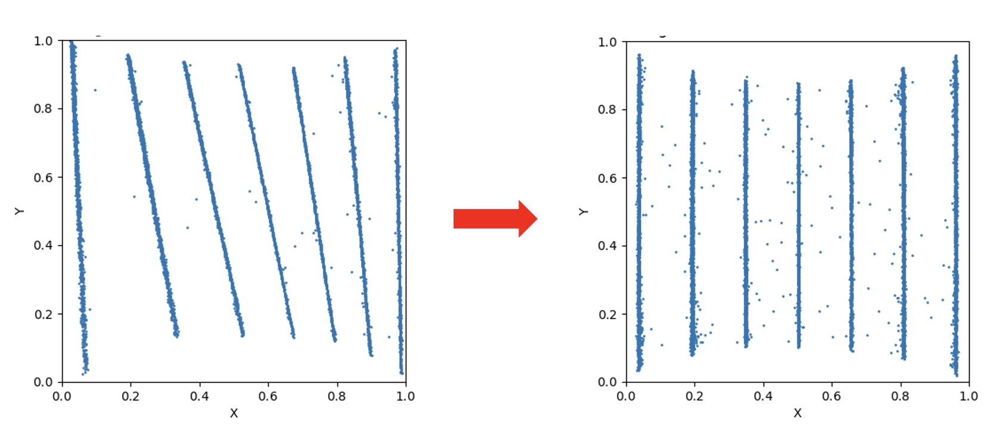

An application of the Hough Transform
=====================================

This repo holds data and code snippets used to demonstrate
how the Hough Transform `(/hʌf/)` can be applied to points in 2D 
space to identify lines in the data.

The application comes from the LOKI small angle scattering instrumet
at European Spallation Source, but the problem and solution is 
rather general and can probably be used elsewhere.

So the situation is that we have a set of points (x,y) that cluster around
lines as shown below in the left image. We want to 'straighten' these lines
out so they look like those on the right image.

  End goal is to 'rectify' points that cluster around lines.

  So the problems consists of two sub problems

  1 finding the line equations for a given set of (x,y) points
  2 translating and rotating the points to straighten out the lines

  

.. toctree::
   :caption: Table of Contents
   :maxdepth: 3

   introduction
   files
   examples
