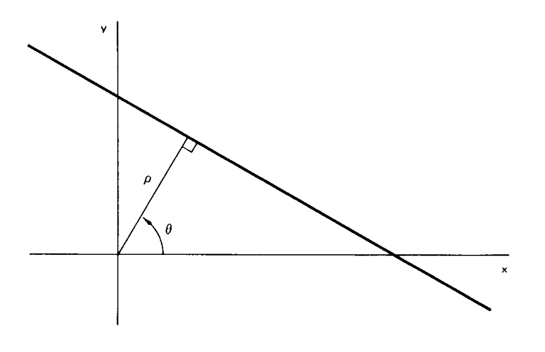
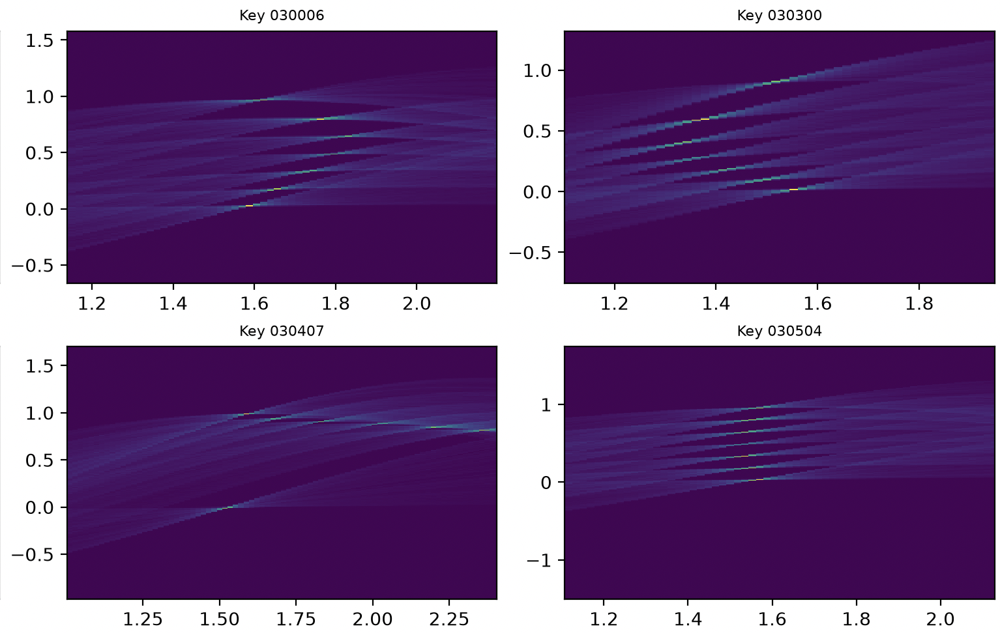
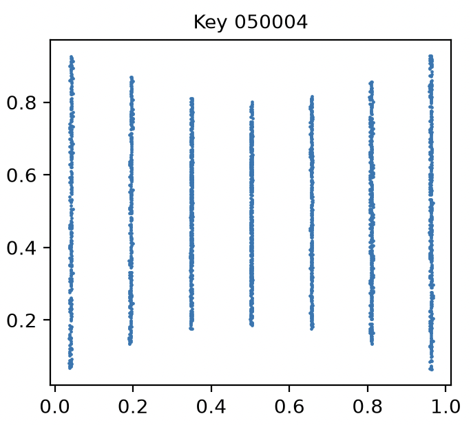

Algorithm History
=================

I recently discovered the Hough Transform, first mentioned in 1959, that seems 
to solve the problem in an elegant and effectve way.

The original paper (1959) [#f1]_ is not directly applicable to computer
implementation, and so later developments have made the idea more tenable.
Applied to the field of finding geometric figures in images, the first
'modern' reference is from 1972 [#f2]_.
Interestingly, the Hough Transform is claimed to be a particular application of 
the Radon Transform (1917) [#f3]_.

.. rubric:: Footnotes

.. [#f1] `Machine Analysis of Bubble Chamber Pictures <http://inspirehep.net/record/919922/files/HEACC59_598-602.pdf>`_ 
.. [#f2] `Use of the Hough transformation to detect lines and curves in pictures <https://dl.acm.org/doi/10.1145/361237.361242>`_
.. [#f3] `Radon Transform <https://en.wikipedia.org/wiki/Radon_transform>`_

Finding Lines
=============

A line is described by two parameters, (:math:`\rho, \theta`). Where :math:`\rho` is the 
perpendicular (algebraic) distance to the line, and :math:`\theta` is the angle of :math:`\rho`.
In general, the parameters can be restricted to :math:`-R \le \rho \le R`, where R is 
given by the most distant point, and :math:`0 \le \theta \lt \pi`.

  Definition of :math:`\rho` and :math:`\theta`.

We now create an accumulator matrix by discretizing the (:math:`\rho, \theta`) space. 
Any line through a point(x,y) will contribute only with a subset of the possible 
(:math:`\rho, \theta`) values: (:math:`\rho_1, \theta_1`), ... (:math:`\rho_n, \theta_n`).

The accumulator matrix is then incremented for these value pairs. It is clear that if many 
points lie on the same line, then the accumulator will be incremented often for some 
very specific values. Finding the most likely line is then a matter of finding the 
(:math:`\rho_i, \theta_i`) pair of the accumulator entry with the highest count.

  Accumulator heatmaps

The ESS LOKI case
=================

This section provides some LOKI specific details that have been included
just in case you were interested.

In this particular application, there are some restrictions due to electric 
engineering. For example there should always be seven lines and all (x,y)
values are in the unit interval from 0.0 to 1.0.

The LOKI detectors consist of stacking of detector tubes that are bring 
read-out by frontend nodes arranged optical rings.

I use the Ring, FEN, Tube identifiers to create dictionary keys like 
'020501' meaning Ring 2, FEN 5 Tube 1. Each tube will have data 
arranged in vertical lines. In the normal (good) case they look like this.

  Normal (good) LOKI data. Here from Ring 5, FEN 0, Tube 4.

